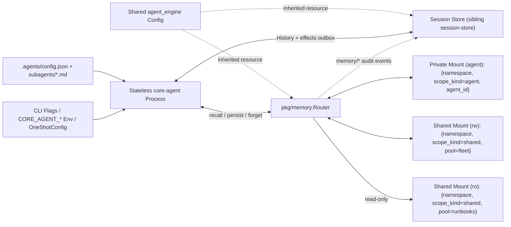
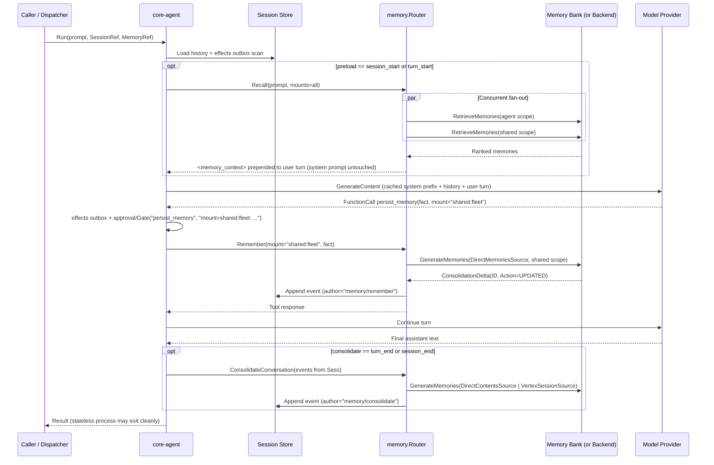

# Memory service: stateless agent-specific and shared memory with Memory Bank

**Status:** proposed, 2026-11-06. Design of record for stateless and
multi-session long-term memory; supersedes
[`docs/archive/shared-memory-design.md`](./archive/shared-memory-design.md) and refines
[`docs/external-state-design.md`](./external-state-design.md) § Memory.

## Motivation

`core-agent` is moving toward a **stateless process model**: a caller or
dispatcher (Cloud Run request/job, Kubernetes Job, AX task runner, Scion
sandbox, or CLI) spins up a `core-agent` process, hands it a **session
reference** (designed in the sibling session-store workstream) and a
**memory reference + scope bindings** (via CLI flags, environment
variables, `OneShotConfig` / `compose.RunConfig`, or `.agents/config.json`),
executes one or more turns, and exits with zero local disk state. The
same memory layer must work identically inside long-lived `--multi-session`
daemons.

Long-term memory in multi-agent systems has two distinct audiences that
cannot share a single undifferentiated bucket:

1. **Agent-specific (private) memory:** operational heuristics, tool
   quirks, schema notes, and domain lessons specific to one agent or
   specialist subagent role (for example, `db-investigator` vs.
   `gke-triage` vs. `incident-comms`). Mixing every specialist's working
   lessons into one global pool pollutes unrelated agents' context and
   degrades retrieval precision.
2. **Agent-shared memory:** durable team-wide findings (`shared:fleet`),
   curated operator knowledge bases (`shared:runbooks`, mounted
   read-only by workers), and cross-agent user preferences
   (`shared:user-prefs`, partitioned by `user_id` across specialist
   agents serving the same person).

Our primary managed target is **Gemini Enterprise Agent Platform Memory
Bank**
(<https://docs.cloud.google.com/gemini-enterprise-agent-platform/scale/memory-bank>),
consumed directly as a data-plane client API from Go (per
[`docs/agent-runtime-go-friction-log.md`](./agent-runtime-go-friction-log.md)),
while keeping the abstraction clean and pluggable for local SQLite FTS5,
in-memory test stores, Redis Agent Memory Server, Postgres/`pgvector`, or
MCP-backed memory services.

### Why ADK v2's `memory.Service` and `memory/vertexai` are not enough directly

`google.golang.org/adk/v2` (`v2.6.0`) ships `adk/v2/memory.Service` and
`adk/v2/memory/vertexai`, plus `loadmemorytool` and `preloadmemorytool`.
Inspecting their implementation reveals five structural gaps for
`core-agent`:

1. **Single-key user scope only.** `memory/vertexai` hardcodes
   `Scope: map[string]string{"user_id": req.UserID}`. It cannot express
   agent-specific vs. shared scopes, multi-tenant `namespace` isolation,
   or custom scope keys.
2. **Lossy retrieval.** `memory/vertexai` discards `Memory.Name` (the
   resource ID), `Topics`, `CreateTime`, `UpdateTime`, and similarity
   `Distance`, returning bare `genai.Content` text with empty IDs and
   zero timestamps.
3. **No direct writes or deletion.** `adk/v2/memory.Service` has only
   `AddSessionToMemory` and `SearchMemory` — no explicit `Remember`
   (`CreateMemory` / `DirectMemoriesSource`) and no `Forget`
   (`DeleteMemory`).
4. **Coupled to Agent Engine Sessions.** `memory/vertexai`'s
   `AddSessionToMemory` only sends `VertexSessionSource`, which fails
   whenever the session store is SQLite, Postgres, Redis, or GCS rather
   than Vertex Agent Engine Sessions in the same `ReasoningEngine`.
5. **Prompt-cache invalidation and per-step RPC amplification.** ADK's
   `preloadmemorytool` runs inside `ProcessRequest` on *every* model step
   of a turn (issuing $N$ duplicate `RetrieveMemories` RPCs across an
   $N$-step tool loop) and appends retrieved text onto the system
   instruction, invalidating Vertex Context Caching and Anthropic system
   prompt caching on every turn.

We solve this by defining a backend-neutral `pkg/memory` package with
first-class multi-scope routing, implementing `pkg/memory/memorybank`
directly on `cloud.google.com/go/aiplatform/apiv1beta1.MemoryBankClient`,
and providing a thin `memory.AsADKService` adapter so `runner.Config.MemoryService`
remains populated for third-party ADK tools.

---

## Settled decisions (do not relitigate)

1. **Two-layer package split preserving the slim-embed dependency ceiling.**
   - `pkg/memory` (`promised` in `dev/api-surface.txt`) is a pure-Go leaf
     package importing only the standard library, `adk/v2/memory`, and
     `adk/v2/session`. `pkg/agent` imports `pkg/memory` without pulling
     cloud gapic clients or SQLite drivers into `./examples/embed/slim`.
   - `pkg/memory/memorybank` and `pkg/memory/sqlfts` live in separate
     subpackages imported by `pkg/compose`, `cmd/core-agent`, or explicit
     library callers. Both subpackages and `cloud.google.com/go/aiplatform`
     are added to the denylist in `dev/tools/verify-slim-deps`.

2. **Multi-scope mounts (`0..1` private `agent` scope + `0..N` named
   `shared:<pool>` scopes) over exact-match `ScopeMap`s.**
   - Memory Bank enforces **exact key-value map equality** on `scope`
     (`map[string]string`, maximum 5 keys, no wildcards `*`, no subset
     queries). Storing `agent_id` inside one flat scope would make
     "recall across all agents in this namespace" impossible on Memory
     Bank.
   - Instead, each agent's `memory.Router` mounts discrete, deterministic
     scopes:
     - Optional **private mount** (`"agent"`):
       `{"namespace": <ns>, "scope_kind": "agent", "agent_id": <id>}`
       (plus `"user_id": <uid>` when `partition_by_user: true`).
     - Zero or more **shared mounts** (`"shared:<pool>"`):
       `{"namespace": <ns>, "scope_kind": "shared", "pool": <pool>}`
       (plus `"user_id": <uid>` when `partition_by_user: true`, or raw
       `scope_attrs` override for interoperating with pre-existing Python
       ADK Memory Banks).
   - Every mount carries an `AccessMode` (`rw` or `ro`), enforceable both
     in-process (`memory.Router` + `permissions.Gate`) and in GCP IAM via
     CEL conditions on `aiplatform.googleapis.com/memoryScope`.

3. **Concurrent fan-out recall with provenance tags.**
   - `Router.Recall` fans out `Backend.Retrieve` concurrently across all
     targeted mounts via `errgroup`, merges and ranks items, caps to
     `TopK`, and stamps `Mount` (`"agent"` or `"shared:<pool>"`) and
     `ReadOnly` on every returned `Item` so the model knows whether a
     recalled fact is private role memory or shared team knowledge.

4. **Shared `agent_engine` config block + self-contained `--memory-ref`
   override, obeying `Config.EnvRefs()`.**
   - Because deployments on Gemini Enterprise Agent Platform typically
     host both Session Store and Memory Bank under one `ReasoningEngine`
     resource (`projects/{p}/locations/{l}/reasoningEngines/{id}`),
     `.agents/config.json` provides a top-level `agent_engine` block that
     both `session` and `memory` inherit when `memory.backend == "memorybank"`.
   - Callers can override with a self-contained `--memory-ref`
     (`CORE_AGENT_MEMORY_REF`) or `memory.ref` / `memory.ref_env`. Every
     env-referencing config field uses the `*_env` suffix so
     `Config.EnvRefs()` (`pkg/config/envrefs.go`) tracks it automatically
     against `.agents/env.yaml`.

5. **Memory Bank writes and extraction are decoupled from session-store
   choice.**
   - Explicit `persist_memory` writes default to `WriteConsolidate`
     (`GenerateMemories` with `DirectMemoriesSource`, chunked at Memory
     Bank's 5-fact-per-request limit) so Memory Bank merges updates and
     resolves contradictions within the target scope; `WriteVerbatim`
     (`CreateMemory`) is selectable per mount.
   - Opt-in conversation extraction (`consolidate: "off" | "turn_end" | "session_end"`,
     default `"off"`) uses `GenerateMemories` with
     **`DirectContentsSource`** built from `session.Session.Events()`, so
     Memory Bank works over SQLite, Postgres, Redis, or GCS sessions.
     When the session store implements the optional `VertexSessionOrigin`
     interface for the same `ReasoningEngine`, `memorybank` upgrades to
     the zero-copy `VertexSessionSource` path automatically.

6. **Explicit gated tools by default; no silent background capture.**
   - Agents receive `recall_memory` (`ClassReadOnly`) and, when at least
     one mount is `rw`, `persist_memory` and `forget_memory`
     (`ClassMutating`). Conversation extraction (`consolidate`) defaults
     to `"off"` and is surfaced in startup/status output whenever enabled.

7. **Prompt-cache-safe preload (`preload: "off" | "session_start" | "turn_start"`).**
   - Default is `"off"`. When enabled, preload runs **once per user turn**
     before step 0 of `Agent.Run` (never inside per-step `ProcessRequest`)
     and prepends a `<memory_context>` block to the user turn message,
     leaving layers 1–5 of `assembleInstruction` byte-identical across
     turns so Vertex Context Caching and Anthropic prompt caching stay warm.

8. **Gate enforcement, durable outbox safety, scope-verified deletes, and
   transcript audit.**
   - Every memory tool passes through `permissions.Gate`. Mutating gate
     details include the target mount (`mount=agent` vs.
     `mount=shared:fleet`) so policy rules and `auto` mode can allow
     private writes while gating or refusing shared writes.
   - Under `docs/durable-write-gate-design.md`, `persist_memory` and
     `forget_memory` are `ClassMutating` (covered by `internal/effects`
     so crash-replay never duplicates writes) and `recall_memory` is
     `ClassReadOnly`.
   - `forget_memory(id, mount)` verifies that the target memory's parent
     resource and `Scope` match the caller's writable `mount` before
     issuing `DeleteMemory`, preventing cross-scope deletion by ID.
   - Every completed `Put`, `Delete`, and `ConsolidateConversation`
     appends a `memory/remember`, `memory/forget`, or
     `memory/consolidate` audit event to the active session transcript.

9. **Subagent isolation, narrowing-by-default, both-doors parity, and
   anti-spoofing.**
   - Operator-declared subagents (`SubagentSpec` in `.agents/config.json`
     or `.agents/subagents/<name>.md`) receive their own private scope
     (`agent_id = subagent.Name`) and inherit parent `shared:*` mounts as
     `ro` by default (`inherit_shared: "ro"`), governed identically on
     both synchronous tool calls (`WithSubagents`) and async reference
     spawns (`spawn_agent {agent: "<name>"}`).
   - Ad-hoc inline `spawn_agent` runs (`allow_adhoc: true`) have no
     stable identity across runs: their private `agent` scope is forced
     `"off"` (preventing spoofed `agent_id` writes) and inherited
     `shared:*` mounts are clamped to `"ro"`.
   - Internal mechanical helpers (`Agent.RunSubtask`) disable memory
     (`nil`).

10. **Multi-session daemon safety via late-bound turn context.**
    - Declarative subagent `*agent.Agent` values are shared across
      sessions (`#741`). Dynamic identity and governance values —
      `UserID` (for `partition_by_user` mounts), session `Gate`, and the
      child `session.Service` receiving `memory/*` audit events — are
      resolved per turn from context rather than baked at construction.

11. **ADK `memory.Service` bridge (`memory.AsADKService`).**
    - When `agent.WithMemory` is wired, `runner.Config.MemoryService` is
      populated with `memory.AsADKService(router)` so any consumer or
      third-party ADK tool calling `toolCtx.SearchMemory` routes through
      the same mounted scopes.

12. **Shared backend conformance suite (`pkg/memory/memtest`).**
    - Every `Backend` (`InMemory`, `memorybank`, `sqlfts`, and external
      adapters) runs one table-driven conformance suite asserting exact
      scope isolation, read-only enforcement, ownership-checked delete,
      fan-out provenance, and consolidation delta reporting.

---

## Architecture overview

### Stateless invocation & multi-scope routing



### Turn lifecycle



---

## Core interfaces (`pkg/memory`)

`pkg/memory` defines the storage-neutral contract, multi-scope `Router`,
URI parser/registry, in-memory backend, and ADK `memory.Service` bridge.

```go
package memory

import (
	"context"
	"time"

	adkmemory "google.golang.org/adk/v2/memory"
	"google.golang.org/adk/v2/session"
)

// AccessMode controls whether a mounted scope permits writes and deletes.
type AccessMode string

const (
	AccessReadWrite AccessMode = "rw"
	AccessReadOnly  AccessMode = "ro"
)

// WriteMode selects how explicit persist_memory calls land in backends
// that support server-side LLM consolidation.
type WriteMode string

const (
	// WriteConsolidate merges candidate facts with existing facts in the
	// same scope (GenerateMemories with DirectMemoriesSource on Memory Bank).
	WriteConsolidate WriteMode = "consolidate"
	// WriteVerbatim writes the fact directly without LLM merging
	// (CreateMemory on Memory Bank; standard insert on FTS backends).
	WriteVerbatim WriteMode = "verbatim"
)

// MaxScopeKeys is the hard key-count ceiling imposed by Vertex AI Memory
// Bank on scope maps; enforced uniformly across all backends so configs
// stay portable.
const MaxScopeKeys = 5

// ScopeMap is the exact-match partition key-value dictionary sent to a
// Backend. Keys and values must be non-empty UTF-8 strings without
// wildcards.
type ScopeMap map[string]string

// MountTemplate defines a logical memory partition mounted on a Router.
// When PartitionByUser is true, Router injects "user_id" from the turn's
// resolved caller/session identity before calling Backend.
type MountTemplate struct {
	Name            string     // "agent" or "shared:<pool>"
	BaseScope       ScopeMap   // static keys (namespace, scope_kind, agent_id/pool, or raw scope_attrs)
	PartitionByUser bool       // adds "user_id": <resolved user> per turn
	Mode            AccessMode // "rw" or "ro"
	WriteMode       WriteMode  // default WriteConsolidate
}

// Item is a single stored or retrieved memory entry.
type Item struct {
	ID        string            `json:"id"`
	Mount     string            `json:"mount,omitempty"`     // stamped by Router ("agent", "shared:fleet")
	ReadOnly  bool              `json:"read_only,omitempty"` // stamped by Router from MountTemplate.Mode
	Fact      string            `json:"fact"`
	Topics    []string          `json:"topics,omitempty"`
	Distance  *float64          `json:"distance,omitempty"` // optional similarity distance (lower = closer)
	Scope     ScopeMap          `json:"scope,omitempty"`
	CreatedAt time.Time         `json:"created_at,omitempty"`
	UpdatedAt time.Time         `json:"updated_at,omitempty"`
	ExpireAt  time.Time         `json:"expire_at,omitempty"`
	Metadata  map[string]string `json:"metadata,omitempty"`
}

// RetrieveRequest queries a single resolved ScopeMap on a Backend.
type RetrieveRequest struct {
	Query  string   // empty lists recent items (SimpleRetrievalParams on Memory Bank)
	Topics []string // optional client-side post-filter when backend lacks native topic filter
	TopK   int      // 0 uses Router/Backend default (10)
}

// CandidateFact is one fact submitted to Backend.Put.
type CandidateFact struct {
	Fact   string
	Topics []string
	TTL    time.Duration
}

// PutRequest writes or consolidates one or more facts into a ScopeMap.
type PutRequest struct {
	Facts     []CandidateFact
	WriteMode WriteMode
}

// ConsolidationDelta reports one mutation produced by Put or
// ConsolidateConversation, persisted into the session audit log.
type ConsolidationDelta struct {
	ID     string `json:"id"`
	Action string `json:"action"` // "CREATED", "UPDATED", "DELETED", "NOOP"
	Fact   string `json:"fact,omitempty"`
}

// ConversationTurn is a sanitized dialogue turn extracted from a
// session.Session for backend-agnostic conversation consolidation.
type ConversationTurn struct {
	Role string // "user" or "model"
	Text string
}

// ConversationRequest asks a Backend to extract and consolidate durable
// memories from session turns.
type ConversationRequest struct {
	SessionID string
	Session   session.Session // optional; checked for VertexSessionOrigin fast path
	Turns     []ConversationTurn
	StartTime *time.Time
}

// Backend is implemented by each storage provider (Memory Bank, SQLite
// FTS5, InMemory, Redis AMS, Postgres, MCP). Each call targets a single
// concrete ScopeMap; multi-scope fan-out and access control live once in
// Router. Implementations must be safe for concurrent use by multiple
// sessions and subagents.
type Backend interface {
	Retrieve(ctx context.Context, scope ScopeMap, req RetrieveRequest) ([]Item, error)
	Put(ctx context.Context, scope ScopeMap, req PutRequest) ([]ConsolidationDelta, error)
	Delete(ctx context.Context, scope ScopeMap, id string) error
	ConsolidateConversation(ctx context.Context, scope ScopeMap, req ConversationRequest) ([]ConsolidationDelta, error)
	Close() error
}

// VertexSessionOrigin is an optional duck-typed interface that the
// Agent Engine session store (from the session-store workstream) may
// implement on its session.Session values. When VertexSessionResource
// returns a session resource under the same ReasoningEngine parent as
// the Memory Bank Backend, ConsolidateConversation uses zero-copy
// VertexSessionSource instead of re-uploading DirectContentsSource.
type VertexSessionOrigin interface {
	VertexSessionResource() (reasoningEngineParent string, sessionResource string, ok bool)
}

// AuditRecorder appends memory/remember, memory/forget, and
// memory/consolidate entries to the active session transcript.
type AuditRecorder func(ctx context.Context, author string, payload map[string]any) error

// Router binds a Backend to an agent's or subagent's mounted scopes,
// enforces AccessMode, resolves per-turn UserID from context, executes
// concurrent fan-out on Recall, and emits audit events on mutations.
type Router struct { /* unexported fields */ }

func NewRouter(backend Backend, mounts []MountTemplate, opts ...RouterOption) (*Router, error)
func (r *Router) Mounts() []MountTemplate
func (r *Router) HasWritableMount() bool
func (r *Router) Recall(ctx context.Context, query string, mounts []string, topics []string, topK int) ([]Item, []MountWarning, error)
func (r *Router) Remember(ctx context.Context, mount string, facts []CandidateFact) ([]ConsolidationDelta, error)
func (r *Router) Forget(ctx context.Context, mount string, id string) error
func (r *Router) ConsolidateSession(ctx context.Context, mount string, sess session.Session, since *time.Time) ([]ConsolidationDelta, error)
func (r *Router) DeriveForSubagent(cfg SubagentDeriveConfig) (*Router, error)

// BindingSpec is the JSON/env-serializable representation of a Router's
// backend URI and scope mounts, passed to out-of-process subagents via
// RemoteAgentSpawner.
type BindingSpec struct {
	Ref       string          `json:"ref"`
	Namespace string          `json:"namespace,omitempty"`
	Mounts    []MountTemplate `json:"mounts"`
}

// AsADKService adapts a Router to google.golang.org/adk/v2/memory.Service
// so runner.Config.MemoryService works with third-party ADK tools.
func AsADKService(r *Router, consolidateMount string) adkmemory.Service
```

### Partial failure handling on fan-out `Recall`

When `Router.Recall` fans out across multiple mounts (for example,
`"agent"`, `"shared:fleet"`, and `"shared:runbooks"`):

- If **all** targeted mounts fail, `Recall` returns the joined error.
- If **some** mounts succeed and an optional shared mount fails (for
  example, an IAM `PermissionDenied` on a restricted pool or a transient
  deadline on one partition), `Recall` returns the items from the
  healthy mounts alongside structured `[]MountWarning` values surfaced in
  the `recall_memory` tool response, so a broken shared pool does not
  blind the agent to its own private memory. Operators can set
  `memory.strict_recall: true` to fail closed on any mount error.

---

## Scope algebra & Memory Bank specification (`pkg/memory/memorybank`)

### Canonical `ScopeMap` construction

Every mount resolves to a deterministic `ScopeMap` with at most 4 keys
(leaving headroom under Memory Bank's 5-key limit):

| Mount kind | `partition_by_user` | Resolved `ScopeMap` sent to backend |
|---|---|---|
| Private (`agent`) | `false` (default) | `{"namespace": ns, "scope_kind": "agent", "agent_id": agentID}` |
| Private (`agent`) | `true` | `{"namespace": ns, "scope_kind": "agent", "agent_id": agentID, "user_id": userID}` |
| Shared (`shared:<pool>`) | `false` (default) | `{"namespace": ns, "scope_kind": "shared", "pool": pool}` |
| Shared (`shared:<pool>`) | `true` | `{"namespace": ns, "scope_kind": "shared", "pool": pool, "user_id": userID}` |
| Custom interop (`scope_attrs`) | `false` / `true` | Exact `scope_attrs` map declared by operator (+ `"user_id"` if `partition_by_user: true`), validated `1 <= len <= 5` |

**Why `scope_attrs` exists:** Organizations adopting `core-agent` alongside
existing Python ADK agents on Gemini Enterprise Agent Platform may
already have a Memory Bank populated under `{"user_id": "<uid>"}` or
`{"app_name": "portal", "user_id": "<uid>"}`. Setting `scope_attrs` on a
shared mount lets `core-agent` read and write those exact Memory Bank
partitions with zero data migration.

**Missing `user_id` guard:** If a mount sets `partition_by_user: true`
and no `user_id` is available on the turn (neither `--memory-user`,
`CORE_AGENT_MEMORY_USER`, authenticated `auth.Caller.Identity`, nor a
non-default `session.UserID()`), `Router` refuses operations on that
mount with `ErrMissingUserIdentity` rather than silently collapsing all
users into `user_id: ""`.

### Memory Bank RPC mapping

`pkg/memory/memorybank` wraps
`cloud.google.com/go/aiplatform/apiv1beta1.MemoryBankClient` against the
regional endpoint `{location}-aiplatform.googleapis.com:443` using ADC by
default (plus optional `option.ClientOption` overrides for tests and
workload identity).

| `Backend` method | Memory Bank RPC (`apiv1beta1`) | Key request / safety details |
|---|---|---|
| `Retrieve` (`Query != ""`) | `RetrieveMemories` (`SimilaritySearchParams`) | `Parent: engineName`, `Scope: scope`, `SearchQuery: req.Query`, `TopK: req.TopK`. Maps `RetrievedMemory.Memory.{Name, Fact, Topics, CreateTime, UpdateTime, ExpireTime}` + `RetrievedMemory.Distance`. |
| `Retrieve` (`Query == ""`) | `RetrieveMemories` (`SimpleRetrievalParams`) | Lists recent memories in `scope` (`PageSize: req.TopK`) when browsing a mount without a similarity query. |
| `Put` (`WriteConsolidate`) | `GenerateMemories` (`DirectMemoriesSource`) | Batches `req.Facts` in chunks of **5** (Memory Bank's per-call `DirectMemories` limit) with `Scope: scope`, waits on the LRO (`op.Wait(ctx)`), and extracts `GeneratedMemory.{Memory, Action}` into `[]ConsolidationDelta`. |
| `Put` (`WriteVerbatim`) | `CreateMemory` | Creates each `Memory{Fact, Scope, Topics, Ttl}` directly via LRO without LLM merging; returns `Action: "CREATED"` with the assigned resource name. |
| `Delete` | `GetMemory` → `DeleteMemory` | Validates `id` (accepts short memory ID or full resource name under `Parent`, rejecting any cross-engine resource path), calls `GetMemory` to verify `got.Scope` equals `scope`, and only then calls `DeleteMemory` LRO. |
| `ConsolidateConversation` | `GenerateMemories` (`DirectContentsSource` or `VertexSessionSource`) | Default: converts `req.Turns` into `DirectContentsSource.Events` (`genai`/`aiplatformpb.Content`) with `Scope: scope`. Fast path: if `req.Session` implements `VertexSessionOrigin` matching `Parent`, sends `VertexSessionSource{Session, StartTime}`. |

### ReasoningEngine provisioning, `memory_topics`, and `ttl_config`

As documented in
[`docs/agent-runtime-go-friction-log.md`](./agent-runtime-go-friction-log.md),
Memory Bank requires an Agent Engine (`ReasoningEngine`) resource parent
(`projects/{project}/locations/{location}/reasoningEngines/{id}`), which
can be provisioned with **no Python code or container** via Terraform
(`google_vertex_ai_reasoning_engine`), `gcloud`, or
`ReasoningEngineClient.CreateReasoningEngine`.

Engine-level extraction behavior is configured on the `ReasoningEngine`'s
`ContextSpec.MemoryBankConfig`:

- **Managed topics (`ManagedMemoryTopic`):** `USER_PERSONAL_INFO`,
  `USER_PREFERENCES`, `KEY_CONVERSATION_DETAILS`,
  `EXPLICIT_INSTRUCTIONS`.
- **Custom topics (`CustomMemoryTopic`):** domain-specific extraction
  definitions (for example, `cluster_topology`, `service_dependencies`,
  `known_regressions` for SRE/platform fleets) with description and
  few-shot examples.
- **TTL (`TtlConfig`):** default expiration window (e.g., `31536000s` /
  365d, or shorter retention for incident scratch pools), supplemented by
  per-write `TTL` on `CandidateFact` when a mount declares `ttl` in
  `.agents/config.json`.

`core-agent` treats `ReasoningEngine` creation and `ContextSpec` schema
updates as infrastructure/provisioning concerns rather than mutating the
shared engine config at agent startup; a future `core-agent memory init`
CLI helper may wrap `CreateReasoningEngine` for developer convenience,
never implicitly during `Run`.

### Defense-in-depth with GCP IAM Conditions (`memoryScope`)

Because our `ScopeMap` separates `scope_kind` (`"agent"` vs. `"shared"`),
`agent_id`, and `pool`, GKE / Cloud Run deployments using Workload
Identity can enforce scope boundaries at the **GCP IAM layer** in
addition to `core-agent`'s in-process `Router` and `permissions.Gate`.

For example, granting the `db-investigator` service account read/write on
its own private scope and `fleet-learnings`, read-only on
`approved-runbooks`, and zero access to other agents' private scopes:

```cel
// Role: roles/aiplatform.memoryUser (read + write)
request.auth.claims != null && (
  (api.getAttribute('aiplatform.googleapis.com/memoryScope', {}).scope_kind == 'agent' &&
   api.getAttribute('aiplatform.googleapis.com/memoryScope', {}).agent_id == 'db-investigator') ||
  (api.getAttribute('aiplatform.googleapis.com/memoryScope', {}).scope_kind == 'shared' &&
   api.getAttribute('aiplatform.googleapis.com/memoryScope', {}).pool == 'fleet-learnings')
)

// Role: roles/aiplatform.memoryViewer (read-only)
api.getAttribute('aiplatform.googleapis.com/memoryScope', {}).scope_kind == 'shared' &&
api.getAttribute('aiplatform.googleapis.com/memoryScope', {}).pool == 'approved-runbooks'
```

### Quotas, retries, and observability

- **Transient retries:** `429 ResourceExhausted` and `503 Unavailable`
  responses from `MemoryBankClient` use the same bounded exponential
  backoff with jitter as provider calls (`#935`), respecting context
  deadlines.
- **OpenTelemetry (`go.opentelemetry.io/otel` API in `pkg/memory`):**
  Every `Router` operation emits a span (`core_agent.memory.recall`,
  `core_agent.memory.remember`, `core_agent.memory.forget`,
  `core_agent.memory.consolidate`) and records latency/counter
  instruments (`core_agent.memory.operations`,
  `core_agent.memory.duration_ms`, `core_agent.memory.items_returned`)
  keyed by `backend`, `mount`, and `status`. Because `pkg/memory` uses
  only the lightweight OTel API (already allowed by `verify-slim-deps`),
  telemetry works out of the box when `pkg/telemetry` is active and is a
  zero-cost no-op in slim embeds.

---

## Configuration, CLI flags, env vars, and stateless references

### Precedence order

Configuration resolves from highest to lowest priority:

1. **Programmatic Go options / fields:** `agent.WithMemory(router)` or
   `OneShotConfig.Memory` / `OneShotConfig.MemoryConfig` (and
   `compose.RunConfig`).
2. **CLI flags:** `--memory-ref`, `--agent-engine`, `--memory-namespace`,
   `--memory-agent`, `--memory-user`, `--memory-shared`,
   `--memory-preload`, `--memory-consolidate`.
3. **Process environment overrides:** `CORE_AGENT_MEMORY_REF`,
   `CORE_AGENT_AGENT_ENGINE`, `CORE_AGENT_MEMORY_NAMESPACE`,
   `CORE_AGENT_MEMORY_AGENT`, `CORE_AGENT_MEMORY_USER`,
   `CORE_AGENT_MEMORY_SHARED`.
4. **Recipe files:** `.agents/config.json` (`agent_engine` + `memory` +
   `subagents[].memory`), `.agents/subagents/*.md` YAML frontmatter
   (`memory:`), and `workload.yaml`, resolving any `*_env` fields via
   `os.Getenv`.
5. **Default:** memory disabled (`nil` router, no memory tools
   registered, zero network calls).

### `.agents/config.json` schema (`pkg/config`)

```json
{
  "version": 1,
  "model": {
    "provider": "vertex",
    "name": "gemini-2.5-pro",
    "project": "my-gcp-project",
    "location": "us-central1"
  },
  "agent_engine": {
    "resource_env": "CORE_AGENT_AGENT_ENGINE"
  },
  "memory": {
    "backend": "memorybank",
    "namespace": "prod-sre",
    "agent": {
      "id": "incident-coordinator",
      "mode": "rw",
      "write_mode": "consolidate",
      "partition_by_user": false
    },
    "shared": [
      {
        "pool": "fleet-learnings",
        "mode": "rw",
        "write_mode": "consolidate",
        "ttl": "7776000s"
      },
      {
        "pool": "approved-runbooks",
        "mode": "ro"
      },
      {
        "pool": "user-prefs",
        "mode": "rw",
        "partition_by_user": true
      }
    ],
    "preload": "off",
    "consolidate": "off",
    "consolidate_mount": "agent",
    "top_k": 10,
    "strict_recall": false
  }
}
```

#### Shared `agent_engine` block & resource resolution

Because a deployment on Gemini Enterprise Agent Platform typically uses
the **same** `ReasoningEngine` instance for both Session Store and Memory
Bank, `Config.AgentEngine` (`pkg/config`) provides a single place to
declare it:

```go
type AgentEngineConfig struct {
	// Full resource name: "projects/{p}/locations/{l}/reasoningEngines/{id}"
	Resource    string `json:"resource,omitempty" yaml:"resource,omitempty"`
	ResourceEnv string `json:"resource_env,omitempty" yaml:"resource_env,omitempty"`

	// Component form when Project/Location come from model.* or ADC env:
	Project     string `json:"project,omitempty" yaml:"project,omitempty"`
	ProjectEnv  string `json:"project_env,omitempty" yaml:"project_env,omitempty"`
	Location    string `json:"location,omitempty" yaml:"location,omitempty"`
	LocationEnv string `json:"location_env,omitempty" yaml:"location_env,omitempty"`
	ID          string `json:"id,omitempty" yaml:"id,omitempty"`
	IDEnv       string `json:"id_env,omitempty" yaml:"id_env,omitempty"`
}
```

When `memory.backend == "memorybank"` (or `--memory-ref` uses
`memorybank://`), the `ReasoningEngine` resource resolves in order:

1. Explicit `--memory-ref` / `CORE_AGENT_MEMORY_REF` / `memory.ref` /
   `memory.ref_env`.
2. `memory.memorybank.resource` / `memory.memorybank.resource_env`.
3. Shared `agent_engine.resource` / `agent_engine.resource_env` (or
   `--agent-engine` / `CORE_AGENT_AGENT_ENGINE`).
4. Assembled from `(memory.memorybank.id || agent_engine.id)` +
   `(agent_engine.project || model.project || GOOGLE_CLOUD_PROJECT)` +
   `(agent_engine.location || model.location || GOOGLE_CLOUD_LOCATION)`.

Every `*Env` field ends in `_env` so `Config.EnvRefs()`
(`pkg/config/envrefs.go`) discovers it automatically for `.agents/env.yaml`
drift checks.

### URI grammar (`--memory-ref` / `CORE_AGENT_MEMORY_REF`)

| Backend | Canonical URI examples |
|---|---|
| Memory Bank (full resource) | `memorybank://projects/my-proj/locations/us-central1/reasoningEngines/123456789` |
| Memory Bank (compact) | `memorybank://my-proj/us-central1/123456789` |
| Local SQLite FTS5 | `sqlite:///var/lib/core-agent/memory.db` |
| Hermetic In-Memory | `inmemory://default` |
| External registered scheme | `redis-ams://memory.svc:8000?tls=true`, `postgres://...` (via `memory.RegisterOpener`) |

### Stateless CLI & Go library invocation examples

**Stateless CLI invocation (zero `.agents/config.json` on disk):**

```bash
core-agent \
  --session-ref "agentengine://projects/my-proj/locations/us-central1/reasoningEngines/12345" \
  --session-id "inc-2026-1106-42" \
  --memory-ref "memorybank://projects/my-proj/locations/us-central1/reasoningEngines/12345" \
  --memory-namespace "prod-sre" \
  --memory-agent "gke-triage" \
  --memory-shared "fleet-learnings:rw" \
  --memory-shared "approved-runbooks:ro" \
  -p "Investigate CrashLoopBackOff in namespace payments"
```

**Or sharing `--agent-engine` across both Session Store and Memory Bank:**

```bash
export CORE_AGENT_AGENT_ENGINE="projects/my-proj/locations/us-central1/reasoningEngines/12345"
core-agent -c /app/.agents/config.json --session-id "inc-2026-1106-42" -p "..."
```

**Go embedding (`compose.Run` / `agent.RunOneShot`):**

```go
res, err := compose.Run(ctx, compose.RunConfig{
    Dir:       "/app/recipe", // loads .agents/config.json + subagents/*.md
    SessionID: sessionID,
    SessionService: sessionSvc, // from session-store workstream
    MemoryConfig: &config.MemoryConfig{
        Ref:       os.Getenv("CORE_AGENT_MEMORY_REF"),
        Namespace: "prod-sre",
        Agent:     &config.AgentMemoryConfig{ID: "gke-triage", Mode: "rw"},
        Shared: []config.SharedMemoryConfig{
            {Pool: "fleet-learnings", Mode: "rw"},
            {Pool: "approved-runbooks", Mode: "ro"},
        },
    },
}, prompt)
```

---

## Subagent & multi-agent memory model

`core-agent` has six distinct subagent / delegation execution paths. A
memory design that leaves subagent scoping implicit either leaks the
parent's private scope into every specialist or lets ad-hoc subagents
poison shared fleet knowledge.

### Subagent configuration (`SubagentSpec.Memory`)

Both `.agents/config.json` (`subagents[].memory`) and Markdown subagents
(`.agents/subagents/<name>.md` YAML frontmatter, decoded with
`KnownFields(true)` in `pkg/config/subagents_markdown.go`) accept an
optional `memory` block:

```yaml
---
name: db-investigator
description: Investigates Cloud SQL and Postgres lock contention and query plans.
mode: task
capability: read_only
tier: mid
memory:
  agent: rw            # "rw" | "ro" | "off"
  agent_id: ""         # optional; defaults to subagent name ("db-investigator")
  inherit_shared: ro   # "ro" (default) | "rw" (clamped to parent's mode) | "off"
  shared:              # optional additional pools or per-pool mode overrides
    - pool: db-heuristics
      mode: rw
  preload: off         # "off" (default) | "turn_start"
---
```

#### Default derivation rules (`Router.DeriveForSubagent`)

When the parent agent has no `memory.Router` (`nil`), subagents also run
without memory unless a rooted subagent bundle (`spec.Root != ""`)
declares its own `memory` backend. When the parent *does* have a
`memory.Router`, defaults depend on the subagent's kind and mode:

| Subagent path | Private `agent` scope default | Inherited parent `shared:*` default | Memory tools registered? | Notes |
|---|---|---|---|---|
| **1. Declarative sync (`mode: "chat"` / `"task"`, `capability != "read_only"`)** | `rw` (`agent_id = spec.Name`) | `ro` (`inherit_shared: "ro"`) | `recall_memory` + (`persist_memory`, `forget_memory` if any mount `rw`) | Specialist accumulates its own private heuristics; reads team knowledge safely; writes shared pools only when opted in. |
| **2. Declarative sync (`capability: "read_only"`)** | `ro` (`agent_id = spec.Name`) | `ro` (`inherit_shared: "ro"`) | `recall_memory` only (unless `memory.agent: "rw"` explicitly set) | Honors `read_only` posture by default; operator may still opt into `agent: "rw"` for specialist note-taking. |
| **3. Declarative `mode: "single_turn"`** | `off` | `ro` (used only if `preload: "turn_start"`) | **None** (`single_turn` is toolless by contract) | Zero overhead when `preload: "off"` (default); read-only preload available when opted in. |
| **4. Rooted subagent bundle (`spec.Root != ""`)** | Bundle's `.agents/config.json` `memory`, else rules 1–3 | Bundle's `memory.shared`, else `ro` inheritance | Per resolved mounts | Shares parent's `Backend` connection unless rooted config declares a distinct `ref` / `agent_engine`. |
| **5a. Async `spawn_agent` by predefined name (`agent: "<name>"`)** | **Identical to `SubagentSpec.Memory` (rules 1–4)** | **Identical to `SubagentSpec.Memory`** | Per resolved mounts | Both-doors parity (`config.go` `SubagentSpec` contract). Per-spawn `RefOverrides` may only **narrow** (`rw` → `ro` → `off`), never widen. |
| **5b. Async ad-hoc inline `spawn_agent` (`allow_adhoc: true`, no predefined spec)** | **`off` (mandatory, non-overridable)** | **`ro` (clamped)** | `recall_memory` only | Ad-hoc inline personas have no stable identity; forcing `agent: "off"` prevents hallucinated or prompt-injected names from spoofing a predefined subagent's `agent_id`. |
| **6. Internal micro-subtask (`Agent.RunSubtask`, e.g. `agentic_*` digesters)** | **`off` (`nil`)** | **`off` (`nil`)** | **None** | Mechanical output-extraction wrappers never touch long-term memory. |

### Out-of-process & cross-boundary subagents

1. **Same-trust remote workers (`background.RemoteAgentSpawner` — Scion,
   Kubernetes Jobs, Cloud Run jobs):**
   - `background.RemoteAgentSpec` (`pkg/agent/background/remote.go`)
     gains `Memory *memory.BindingSpec`, populated by
     `Router.DeriveForSubagent` using the exact narrowing rules above
     (including `agent: "off"` + `shared: "ro"` when the remote spawn is
     ad-hoc rather than predefined).
   - The spawner serializes `BindingSpec` onto the worker container's
     `CORE_AGENT_MEMORY_*` environment variables or `--memory-*` CLI
     flags. The stateless worker connects directly to the backing memory
     service under its own process lifecycle.
2. **Cross-boundary A2A subagents (`SubagentRemoteConfig` in
   `pkg/compose/a2a.go`):**
   - An external HTTP A2A v0.3 endpoint is a separate service with its
     own credentials and storage boundary; `core-agent` **never** sends
     raw `MemoryRef` URIs across A2A requests.
   - For first-party A2A fleets sharing a Memory Bank under Workload
     Identity, setting `remote.propagate_memory_scope: true` on the
     `SubagentSpec` attaches non-secret scope metadata (`namespace`,
     `user_id`, and allowed `shared` pool names) in A2A
     `Message.Metadata["core_agent.memory_scope"]`. Each A2A service
     enforces access via its own service account and GCP IAM Conditions.

### Multi-session daemon & durable outbox behavior for subagents

- **Shared `*agent.Agent` safety (`#741`):** In `compose.SessionFactoryDeps`,
  declarative subagents are constructed once at daemon startup and wrapped
  per session by `NewSubagentTool` (`pkg/agent/subagent.go`). `Router`
  reads `UserID` (`auth.CallerFromContext` / `ParentUserID`), the session
  `Gate` (`resolveSessionGate`), and the audit-event target dynamically
  from the `tool.Context` / `context.Context` on each call — nothing
  session-specific is stored on the shared `Inner *agent.Agent`.
- **Child-session outbox replay (`#1400`):** Synchronous `chat`/`task`
  subagents run on deterministic child session IDs
  (`<parentSID>:sub:<subName>:<callID>`) wrapped by
  `effects.WrapSubRunner` (`docs/durable-write-gate-design.md` decision 6).
  Because `persist_memory` and `forget_memory` are `ClassMutating`, a
  crash mid-delegation replays already-completed subagent memory writes
  from the child session's `FunctionResponse` without re-issuing
  `GenerateMemories` or `DeleteMemory`.

---

## Model-facing tools, preload, and governance

### Registered tools (`pkg/memory/memtools` or `pkg/tools`)

Tools are constructed from the agent's `*memory.Router` and wrapped
through `tools.GateTools`:

1. **`recall_memory`** (`ClassReadOnly`)
   - Registered whenever `Router != nil` and `len(Router.Mounts()) > 0`
     (unless disabled in `config.Tools.Disable`).
   - Arguments:
     - `query` (`string`, required): search text describing the facts,
       constraints, prior incidents, or preferences needed.
     - `mount` (`string`, optional): `"all"` (default), `"agent"`, or a
       mounted `"shared:<pool>"` name.
     - `top_k` (`integer`, optional): maximum items to return (`1..50`,
       default from `memory.top_k`).
   - Returns `{items: []Item, warnings?: []MountWarning}`, with `mount`
     and `read_only` populated on every item.

2. **`persist_memory`** (`ClassMutating`)
   - Registered **only** when `Router.HasWritableMount()` is true (per
     the tool-description truth rule in `AGENTS.md`: when all mounts are
     `ro`, the tool is absent rather than advertising writes that always
     fail).
   - Arguments:
     - `fact` (`string`, required): self-contained factual statement,
       constraint, user preference, or verified operational rule to
       retain across sessions (markdown/plain text; never executable
       code).
     - `mount` (`string`, optional): target writable mount (`"agent"` by
       default when `"agent"` is writable; required when `"agent"` is
       absent or `ro` and only `shared:*` mounts are writable).
     - `topics` (`[]string`, optional): topic labels categorizing the
       fact.
   - Returns `{deltas: []ConsolidationDelta, mount: string}`.

3. **`forget_memory`** (`ClassMutating`)
   - Registered **only** when `Router.HasWritableMount()` is true.
   - Arguments:
     - `id` (`string`, required): identifier of the memory item to delete
       (as returned by `recall_memory`).
     - `mount` (`string`, required): writable mount (`"agent"` or
       `"shared:<pool>"`) that owns `id`.
   - Verifies both that `mount` is `rw` and (on backends where IDs are
     globally addressable, including Memory Bank) that `id`'s stored
     `Scope` equals `mount`'s `ScopeMap` before deleting.

#### Neutrality sweep compliance

All tool descriptions and `jsonschema` argument tags must pass
`internal/testutil.ModelFacingBans` (`internal/testutil/modelfacing.go`):
no genre words (`"summary"`, `"status update"`), no frequency
instructions (`"generously"`), and no code-only assumptions (`"the
codebase"`). The package registering these tools carries a
`description_neutrality_test.go` and is added to the package list in
`internal/testutil/modelfacing_coverage_test.go`
(`TestEveryToolRegisteringPackageHasASweep`).

### Permission gate keys

`tools.GateTools` extracts mount-qualified detail keys so operator
policies (`permissions.allow`, `permissions.deny`) and the `auto` mode
approver (`pkg/approver`) can distinguish private vs. shared memory
operations:

- `recall_memory`: detail `mount=<mount> query=<truncated>`
- `persist_memory`: detail `mount=<mount> fact=<truncated>`
- `forget_memory`: detail `mount=<mount> id=<id>`

An operator can therefore configure:

```json
{
  "permissions": {
    "mode": "ask",
    "allow": [
      "recall_memory",
      "persist_memory(mount=agent *)"
    ]
  }
}
```

allowing autonomous writes to the agent's own private memory while
prompting (or parking durably via `pkg/approval`) before mutating a
shared fleet pool.

### Prompt-cache-safe preload (`preload`)

When `memory.preload` is `"session_start"` (first turn of a session only)
or `"turn_start"` (every user turn):

1. Before dispatching the ADK runner in `Agent.Run`, `core-agent` calls
   `Router.Recall(ctx, promptText, nil, nil, preloadTopK)` **once**.
2. If non-empty items are returned, they are formatted with explicit
   provenance and untrusted-content framing and prepended to the user
   `genai.Content` for that turn (never concatenated onto
   `assembleInstruction`):
   ```xml
   <memory_context>
   Recalled long-term memories (verify against live state when acting on mutable infrastructure):
   - [agent | id=mem-123] Query plans on replicas lag primary schema migrations by up to 30s.
   - [shared:approved-runbooks | ro | id=mem-991] Drain traffic via Envoy weight=0 before restarting payments-api pods.
   </memory_context>
   ```
3. Layers 1–5 of the system instruction remain completely static across
   turns, preserving 100% cache hit rates on Vertex Context Caching and
   Anthropic prompt caching, and tool-loop steps inside the turn perform
   zero extra `RetrieveMemories` RPCs.

### Audit trail in the session transcript

Preserving the audit invariant established in
`docs/shared-memory-design.md` and `docs/external-state-design.md`:

- Every completed `Remember` appends a synthetic non-model transcript
  event with `Author: "memory/remember"` and `CustomMetadata` containing
  `{mount, scope, deltas: [{id, action, fact}]}`.
- Every completed `Forget` appends `Author: "memory/forget"` with
  `{mount, scope, id}`.
- Every completed `ConsolidateSession` appends
  `Author: "memory/consolidate"` with `{mount, scope, source, deltas}`.
- If the backend call fails, no audit event is written and the error
  propagates to the caller/model.

---

## Alignment seam with the `session-store` workstream

This design coordinates with the sibling `session-store` architecture on
four narrow, decoupled seams:

1. **Symmetric stateless CLI/env/config references:**
   - `--session-ref <uri>` (`CORE_AGENT_SESSION_REF`) + `--session-id <id>`
     identifies conversation history and durable execution state.
   - `--memory-ref <uri>` (`CORE_AGENT_MEMORY_REF`) + scope mounts
     identifies long-term memory.
   - Either can be used without the other (stateless run with ephemeral
     in-memory session + persistent Memory Bank, or durable session store
     with memory disabled, or both together).
2. **Shared `agent_engine` config block:**
   - When a deployment uses Gemini Enterprise Agent Platform for *both*
     Agent Engine Sessions and Memory Bank, setting top-level
     `agent_engine` in `.agents/config.json` (or
     `CORE_AGENT_AGENT_ENGINE`) configures both subsystems with zero
     duplicated project/location/engine strings.
3. **Storage-agnostic conversation consolidation + zero-copy fast path:**
   - `Router.ConsolidateSession` reads `session.Session.Events()` via
     standard ADK `session.Service` interfaces (`DirectContentsSource`),
     working unmodified over SQLite, Postgres, Redis, or GCS session
     stores.
   - If the Agent Engine `session.Session` implementation in
     `session-store` implements the 1-method `memory.VertexSessionOrigin`
     interface (or an equivalent structural method matched via anonymous
     interface assertion so neither package imports the other!),
     `pkg/memory/memorybank` switches to `VertexSessionSource`
     automatically when both share the same `ReasoningEngine` parent.
4. **Audit events land in whichever `session.Service` is wired:**
   - `AuditRecorder` appends `memory/*` events through `session.Service`
     (`AppendEvent`) rather than requiring a SQLite `*eventlog.Handle`,
     so audit provenance persists in Agent Engine Sessions, Redis,
     Postgres, or SQLite alike.

---

## Pluggable backends beyond Memory Bank

Because `Backend` is a 5-method interface operating on `ScopeMap` and
registered via `memory.RegisterOpener(scheme, opener)`:

1. **`memory.NewInMemory()` (`inmemory://`, Phase 1, in `pkg/memory`):**
   - Thread-safe map partitioned by canonical `ScopeMap` string,
     supporting substring/token BM25-lite scoring, `AccessMode` checks,
     and ownership-checked `Delete`. Powers unit tests, smoke scripts,
     and multi-subagent in-process collaboration without cloud
     credentials.
2. **`pkg/memory/memorybank` (`memorybank://`, Phase 3, in-tree):**
   - Production managed backend on Gemini Enterprise Agent Platform
     Memory Bank (`aiplatform/apiv1beta1.MemoryBankClient`).
3. **`pkg/memory/sqlfts` (`sqlite://`, Phase 4, in-tree):**
   - Pure-Go SQLite FTS5 backend (`glebarez/sqlite` in `pkg/memory/sqlfts`,
     outside the slim slice) partitioned by exact `scope_json` + FTS5
     BM25 ranking, giving single-binary local CLI users full parity with
     multi-scope private + shared memories offline.
4. **External / `extras/` adapters (`redis-ams://`, `postgres://`,
   `mcp://`, Phase 4+):**
   - Redis Agent Memory Server (`extras/redis-memory`), Postgres
     `pgvector`, or an adapter wrapping an MCP memory server's tools
     behind `memory.Backend`.

---

## Implementation phases

### Phase 1: `pkg/memory` core, `memtest` conformance suite, and `pkg/config` schema

- Add `pkg/memory` (`Backend`, `Router`, `MountTemplate`, `ScopeMap`,
  `AccessMode`, `WriteMode`, `BindingSpec`, `ParseRef` / `RegisterOpener` /
  `Open`, `NewInMemory`, `AsADKService`, `VertexSessionOrigin`).
- Add `pkg/memory/memtest` conformance suite and run it against
  `NewInMemory()`.
- Add `AgentEngineConfig`, `MemoryConfig`, and `SubagentMemoryConfig` to
  `pkg/config` (`.agents/config.json`, `.agents/subagents/*.md`
  frontmatter, `workload.yaml`, `Config.EnvRefs()` tests, and validation).
- Classify new packages in **all three** surface-tracked files checked by
  `TestEveryImportablePackageIsADecision`
  (`internal/testutil/surface_test.go`):
  `dev/api-surface.txt`, `docs/compatibility-policy.md`, and the
  `Stability promise` header in `CHANGELOG.md`.
- Verify `dev/tools/verify-slim-deps` passes within `SLIM_MAX_PACKAGES`.

### Phase 2: Tools, gate/outbox integration, preload, subagents, and stateless CLI/compose wiring

- Implement `recall_memory`, `persist_memory`, and `forget_memory` with
  mount-qualified `permissions.Gate` keys, `description_neutrality_test.go`,
  and registration in `internal/testutil/modelfacing_coverage_test.go`.
- Register `recall_memory` as `ClassReadOnly` and
  `persist_memory` / `forget_memory` as `ClassMutating` in `pkg/approval`
  / `internal/effects`.
- Wire `agent.WithMemory`, once-per-turn prompt-cache-safe preload,
  opt-in `turn_end` / `session_end` consolidation, and `memory/*`
  transcript audit events in `pkg/agent`.
- Wire subagent derivation across all 6 paths (`WithSubagents`,
  `background.Manager` predefined + ad-hoc clamping, `RemoteAgentSpec`,
  and A2A scope metadata opt-in).
- Wire `OneShotConfig`, `compose.Run`, `compose.SessionFactoryDeps`, and
  `cmd/core-agent` (`--memory-*` + `--agent-engine` flags and
  `CORE_AGENT_*` env vars), plus a hermetic `dev/smoke/` test exercising
  stateless invocation + private/shared subagent isolation on
  `inmemory://`.

### Phase 3: `pkg/memory/memorybank` backend

- Implement `pkg/memory/memorybank` on
  `cloud.google.com/go/aiplatform/apiv1beta1.MemoryBankClient` (`Retrieve`,
  `Put` consolidate + verbatim, ownership-verified `Delete`,
  `ConsolidateConversation` with `DirectContentsSource` and
  `VertexSessionOrigin` fast path, transient retry, OTel spans/metrics).
- Add `pkg/memory/memorybank` and `cloud.google.com/go/aiplatform` to the
  `DENYLIST` in `dev/tools/verify-slim-deps`.
- Run `memtest` conformance against a hermetic local `MemoryBankServer`
  gRPC fake in unit CI, plus provider-gated live conformance tests
  (`CORE_AGENT_TEST_AGENT_ENGINE`) and a `dev/uat/memory-bank/` recipe.
- Update `docs/site/src/content/docs/` and add a `CHANGELOG.md` entry
  under `[Unreleased]`.

### Phase 4: Local SQLite FTS5 (`pkg/memory/sqlfts`) & external adapters

- Implement `pkg/memory/sqlfts` passing `memtest` conformance for
  zero-cloud local multi-agent memory.
- Add `extras/redis-memory` (or MCP memory adapter) as consumer demand
  warrants.

---

## Out of scope

- **Deploying Go code *onto* Vertex Agent Runtime compute.** Covered in
  [`docs/agent-runtime-go-friction-log.md`](./agent-runtime-go-friction-log.md):
  Go agents run on Cloud Run, GKE, or local hosts and call Memory Bank as
  a client API.
- **Automatic `ReasoningEngine` creation during `agent.Run`.** Provisioning
  infrastructure resources implicitly on agent startup hides IAM failures
  and creates duplicate engines; engines are provisioned via IaC/gcloud
  or an explicit setup command.
- **Agent-authored executable skills or code in memory.** Memory facts
  are plain text / markdown data, never executable scripts or tool
  definitions.
- **Implicit Mem0-style un-audited scraping on every turn by default.**
  `consolidate` is `"off"` by default and always writes a
  `memory/consolidate` audit record when opted into.
- **Wildcard cross-scope queries on Memory Bank.** Excluded by Memory
  Bank's API contract; multi-scope visibility is modeled explicitly by
  mounting named `shared:<pool>` scopes.
- **Model weight updates or online fine-tuning.**
